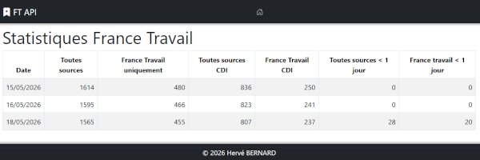

# Consommation de l'API France Travail

## Le projet

Projet Symfony de connexion à une API externe : consommation de l'API France Travail [https://francetravail.io](https://francetravail.io) (fréquence quotidienne) :

Pour la ville d'Amiens avec un rayon de 10 kilomètres :

| Critère publication                    | Source des offres                                                 | Type de contrat |
| -------------------------------------- | ----------------------------------------------------------------- | --------------- |
| Toutes les offres                      | Toutes sources (France Travail, jobboards, intérim, entreprises…) | Tous contrats   |
| Toutes les offres                      | France Travail uniquement                                         | Tous contrats   |
| Toutes les offres                      | Toutes sources                                                    | CDI uniquement  |
| Toutes les offres                      | France Travail uniquement                                         | CDI uniquement  |
| Offres publiées depuis moins d’un jour | Toutes sources                                                    | Tous contrats   |
| Offres publiées depuis moins d’un jour | France Travail uniquement                                         | Tous contrats   |

Affichage sur la page d'accueil et stockage de ces statistiques par date en base de données (seuls les totaux sont conservés, aucune information de contenu des offres d'emploi).

## Aperçu



## Stack technique

* Symfony 7.4 <abbr title="Long-Term Support">LTS</abbr> (webapp)
* API Platform 4.3.3
* PHP >= 8.5.12 et < 8.6
* MySQL 26.10 (Docker Compose)
* Framework CSS Bootstrap

## Docker Compose

Les fichiers `compose.yaml` et `compose.override.yaml` définissent un environnement local avec PHP **8.5.12 / Apache**, MySQL **26.10**, phpMyAdmin **5.2.3** et Mailpit. PHP est fixé à 8.5.12 ; Composer impose également `>=8.5.12 <8.6`.

Démarrer Docker Desktop, puis exécuter :

```bash
docker compose up -d --build
docker compose exec php sh -c "composer install && chown -R www-data:www-data var"
docker compose exec --user www-data php php bin/console doctrine:migrations:migrate --no-interaction
```

* Application : http://localhost:8080
* phpMyAdmin : http://localhost:8081
* MySQL depuis la machine hôte : `127.0.0.1:13306`

Les identifiants MySQL par défaut sont `app` / `!ChangeMe!`, et la base est `sf74_ftapi`. Ils peuvent être personnalisés avec les variables d'environnement du terminal `MYSQL_USER`, `MYSQL_PASSWORD`, `MYSQL_ROOT_PASSWORD` et `MYSQL_DATABASE`. Pour un mot de passe contenant des caractères réservés aux URL, adapter également `DATABASE_URL` dans le service PHP avec son encodage URL. Les ports sont configurables via `HTTP_PORT`, `PHPMYADMIN_PORT` et `MYSQL_PORT`. Docker Compose ne charge pas automatiquement `.env.local` ; Symfony continue à le lire dans le conteneur.

Dans le conteneur PHP, `DATABASE_URL` utilise le nom de service `database` et prend priorité sur la configuration Wamp de `.env.local`. Les dépendances PHP et le cache Docker utilisent leurs propres volumes.

MySQL 26.10 utilise un nouveau volume `database_mysql_26_data`. L'ancien volume `database_data`, s'il existe, est conservé ; ses données ne sont pas importées automatiquement. Pour une installation existante, transférer les données par export/import.

## Etat actuel (Done)

* Installation et configuration de Symfony
* Intégration de Bootstrap via AssetMapper.
* Création d'un compte sur l'API France Travail
* Stockage des identifiants API France Travail dans Symfony Secrets local
* Configuration des paramètres France Travail dans le fichier _config/services.yaml_
* Création d'un service _src/Service/FranceTravailClientService.php_
* Création d'une entité _src/Entity/FtStats.php_ pour le stockage des statistiques en base de données

## Configuration France Travail

Les identifiants applicatifs France Travail sont stockés dans _Symfony Secrets_ (environnement de développement), créés avec les commandes :

```bash
symfony console secrets:set FRANCE_TRAVAIL_CLIENT_ID --env=dev 
symfony console secrets:set FRANCE_TRAVAIL_CLIENT_SECRET --env=dev 
```

Les paramètres non sensibles restent dans `.env` :

```dotenv
FRANCE_TRAVAIL_TOKEN_URL="https://entreprise.francetravail.fr/connexion/oauth2/access_token?realm=/partenaire"
FRANCE_TRAVAIL_API_BASE_URL="https://api.francetravail.io"
FRANCE_TRAVAIL_SCOPE="api_offresdemploiv2 o2dsoffre"
```

## CI et livraison GitHub Actions

Le workflow `.github/workflows/ci.yml` s'exécute sur les pushs, les pull requests et manuellement depuis l'onglet Actions du dépôt GitHub. Il contrôle :

* la cohérence Composer, les prérequis PHP et les alertes de sécurité ;
* la syntaxe PHP, YAML et Twig, les conteneurs Symfony de test et de production et le style PSR-12 ;
* l'analyse statique PHPStan au niveau 5 avec prise en charge de Doctrine ;
* les migrations, le schéma Doctrine et PHPUnit avec MySQL 26.10, sur PHP 8.5.12 et la dernière version 8.5 ;
* la configuration Compose et la construction de l'image PHP.

Les tests utilisent une base éphémère et des identifiants France Travail fictifs. Aucun secret du projet n'est nécessaire. Le rapport JUnit est conservé 14 jours dans les artefacts de la CI. Dependabot propose chaque semaine les mises à jour Composer et GitHub Actions.

Commandes locales disponibles après `composer install` :

```bash
composer lint
composer analyse
composer test
composer audit --locked
```

Utiliser `composer fix:style` pour appliquer le formatage. Dans Docker, préfixer ces commandes par `docker compose exec php` ; pour les tests, préparer une base de test et ses droits d'accès comme indiqué ci-dessous.

Un push d'un tag commençant par `v` (par exemple `v1.0.0`) produit, après réussite de tous les contrôles, l'artefact `ft-api-<tag>`, téléchargeable pendant 30 jours dans l'onglet Actions. Il contient `ft-api.tar.gz` et son empreinte SHA-256. L'archive comprend les dépendances de production et les assets compilés ; les secrets Symfony, fichiers `.env.local`, caches et outils de développement sont exclus et leur absence est vérifiée automatiquement.

Le livrable est destiné à un serveur PHP compatible avec `>=8.5.12 <8.6`. Décompresser l'archive, configurer les variables d'environnement du serveur (`APP_ENV=prod`, `APP_DEBUG=0`, `APP_SECRET`, `DATABASE_URL` et les paramètres France Travail), rendre `var/` accessible en écriture au serveur web, pointer le document root sur `public/`, puis exécuter `php bin/console doctrine:migrations:migrate --env=prod --no-interaction`. Le workflow prépare le livrable ; le transfert sur un hébergement reste manuel.

## Tests

Symfony ignore `.env.local` dans l'environnement `test`. Pour utiliser les identifiants MySQL locaux, créer un fichier `.env.test.local` et y recopier uniquement la ligne `DATABASE_URL` de `.env.local`. Ce fichier est ignoré par Git.

Doctrine ajoute automatiquement le suffixe `_test` au nom de la base : `sf74_ftapi` devient `sf74_ftapi_test`. Ne pas ajouter ce suffixe dans l'URL. Les tests utilisent cette base dédiée et remplacent ses statistiques.

Préparer la base de test, puis lancer la suite :

```bash
php bin/console doctrine:database:create --env=test --if-not-exists
php bin/console doctrine:migrations:migrate --env=test --no-interaction
php bin/phpunit
```

## Import quotidien des statistiques France Travail

La commande Symfony suivante interroge l'API Offres d'emploi de France Travail et enregistre ou met à jour les totaux du jour pour Amiens (`commune=80021`) dans un rayon de 10 km :

```bash
symfony console app:ft-stats:import
```

Les six indicateurs importés sont :

* toutes les offres ;
* toutes les offres publiées depuis moins d'un jour (`publieeDepuis=1`) ;
* toutes les offres en CDI uniquement ;
* les offres publiées par France Travail uniquement ;
* les offres publiées par France Travail uniquement en CDI ;
* les offres publiées par France Travail uniquement depuis moins d'un jour (`publieeDepuis=1`).

> ⚠️ Le total `Toutes sources` de l'API peut être inférieur à celui affiché sur le site francetravail.fr car certaines offres partenaires visibles sur le site ne sont pas forcément diffusables via l'API, selon l'accord de diffusion donné par le partenaire.

Pour une fréquence quotidienne, planifier cette commande via cron ou le planificateur de l'hébergement applicatif, par exemple :

```cron
0 6 * * * cd /chemin/vers/ft-api && php bin/console app:ft-stats:import
```
